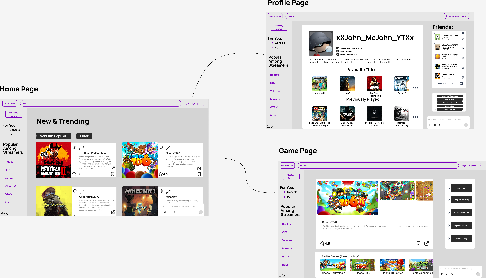
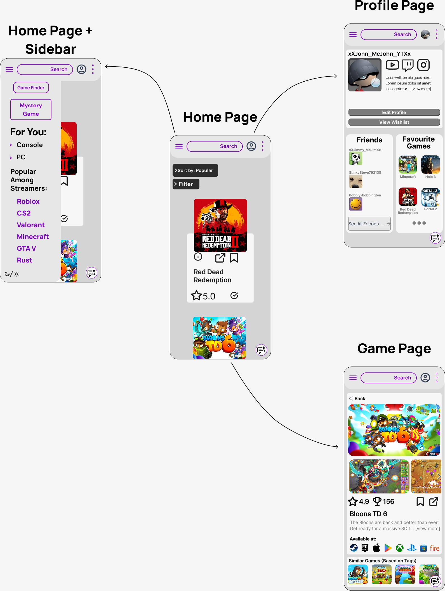

# Designs

## 1.0 Final High Definition Mockups

`For the visual designs, we went for both desktop and mobile designs to show proof of iteration. We excluded some UI features from the Mobile mockups that we included in the desktop version to implement abstraction. More features can be added during development, but for now we simply need an idea of how the program will look. The descriptions will be at the very bottom.`

# Desktop Mockups:  

# Mobile Mockups:

# Descriptions:

## Homepage:    

This will be the initial page that the app would load into. The component which we wish to be used the most is the top games function - with filtering implemented too. However, we have other implementations too such as the search bar which can let you search for specific titles, and the profile icon which will let you either log in to your profile, sign up or redirect you to your own profile. There are 3 dots as well, which will essentially act as a drop-down menu that can let users access a games jargon page or go to user settings.

This allows for users to customise their experience as much as they want (For example changing username, password, email, app appearance (besides light and dark mode)), leading users to having a more bespoke and satisfying in-app experience as they can customise it to their liking.
Furthermore, with the option to search for games and have top games displayed upon loading, this implements the number one feature swiftly and can allow users to get the information they need immediately. It simply accesses the RAWG database and returns the information right away in an aesthetically pleasing and immediately legible format.   

## Homepage + Sidebar

The homepage will also have a sidebar that once clicked, appears on the screen. This allows for further categories such as personalised recommendations and currently popular titles. There is also a light/dark mode feature for those who prefer either one or the other.

This allows for more information to be displayed on the same screen without disruption to user flow. This would save more time and allow for a snappier, more responsive user experience. This would create a more satisfiyng product for consumers all while providing the same level of information with better accessibility compared to if it weren't there (People with slower mobile devices would also greatly benefit from this as it is one less screen that needs to load from scratch).   

## Profile Page:    

This will be what each user profile looks like. This particular mockup is from the perspective of the profile owner. If you are viewing someone else's profile it wouldn't be too different - the user simply wouldn't have the "edit profile option"
This page has the icons for Twitch, Instagram and Youtube. In the "Edit Profile" Section, the user would be able to paste the links to the respective social medias, however if a link isn't included, the icon would not be displayed. Upon clicking the icon, it would redirect the user to the relevant social media site.

This view also includes a Friends List and a section for Favourite Games - this is to make the page interactive for both other viewers and the profile owner themselves. The profile owner can use this to manage friends (unfriend and pin friends to top of list), access friend profiles and DMs. This adds to the User Experience as it makes the app more interactive between the users. If you can interact with other people, you can share games between each other which essentially makes the rest of the service (i.e. game retrieval) be widely used. The same idea applies for the "Favourite Games" section - you can see what other people enjoy playing and check out the game page. Also, upon scrolling down, you can see a section for previously played games.

## Game page:   

This will be the relevant game information displayed. It will include in-game screenshots, rating, trophies available, a bookmark icon (wishlist), and opening the game page (It will default to the steam store page unless specified in user settings). Further, there is a game description, platform availability and similar games.
Under the game description, there would also be tags, developer information, relevant genres and user reviews which would all be displayed neatly for users to view.  

This greatly adds to the user experience because it conveniently displays all the information you need. It's useful having the overall opinion of the game (i.e. the rating), and all the storefronts available. This is different from other storefronts because it directly shows you the availability information. Furthermore, depending on the region you are in/specify in user settings, it will show you where you can buy the game, which saves time if you look on Epic Games and you then see it is not available for that region. This could be useful in the event of age restrictions for certain games - for example if they have too much blood or adult language.