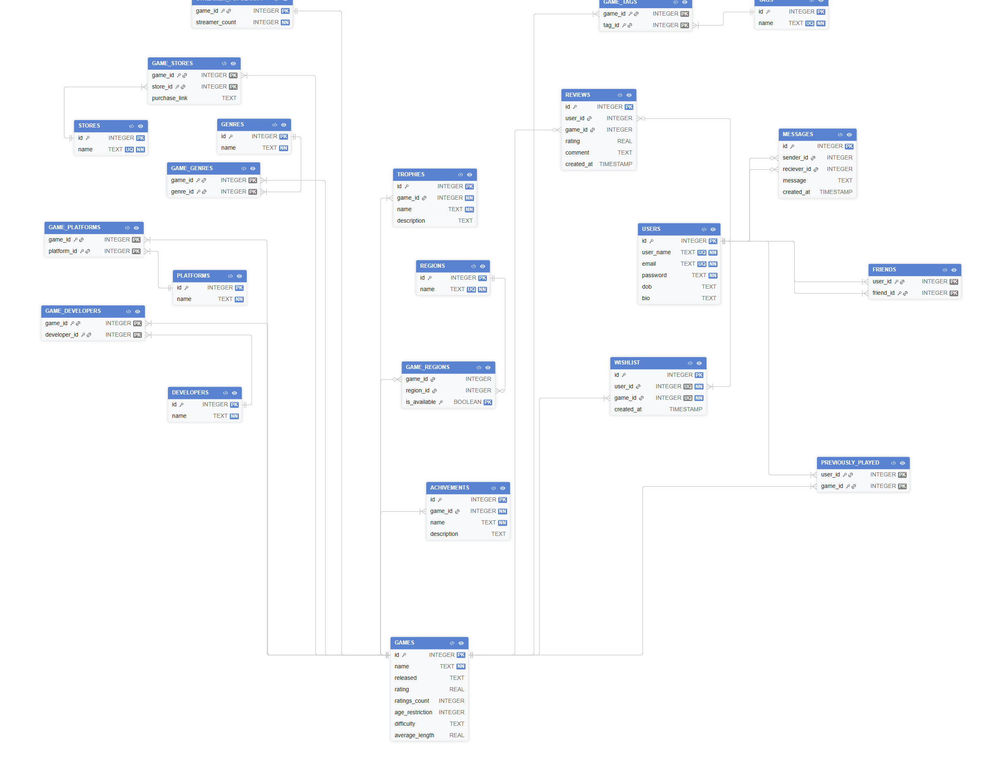

# Architecture & Data Model

## 1. System Architecture

The GameFinder mobile system uses a client-server architecture. The front end consists of a mobile app that lets users search and browse for videogame data (such as popualrity, genre difficulty, playtime etc). The app communicates with a backend server via a REST API using HTTP requests.

The backend is implemented in Java with Javalin and handles client requests, search query processing and retrieving relevant filter data. It uses a SQLite database containing a curated subset of the RAWG videogame database.

When an event is logged (i.e. user performing an action such as searching for a game), the mobile app sends that request to the REST API, which is then processed by the backend. It then queries the database and returns results in JSON format. The mobile app then displays this data to the user. API endpoints must be provided to fetch game data and display it.

Furthermore, users can interact with each other via friend requests and messaging. There is also a user account system in place to accommodate for these features. This requires the backend to manage additional data. As such, it needs to provide API endpoints for user interactions to each individual profile. 

## 2. UML Diagram

<!-- *Insert a UML diagram here (e.g., Mermaid, Diagram.net, or photo of hand-drawn diagram).* -->
Here is the UML Diagram that we created:

## 3. Data Model

New fields added to GAMES table

- age_restriction = stores the age restriction of a specific game.
- difficulty = stores the difficulty of a game.
- average_length = stores the average length of a game.

New tables added:

The new tables extends the existing game database by implementing new functionality/features such as messaging, user reviews, viewing game trophies and e.c.t.

- REVIEWS = stores reviews made by users.

- WISHLIST = stores games a user wishes to play.

- PREVIOUSLY_PLAYED = stores information of a user's previously played games.

- USERS = stores user information such as username and email.

- FRIENDS = stores relationship between users, it includes sender and reciever.

- MESSAGES = stores messages between users, it includes sender,     reciever and message content. Each message individual message represents a record.

- TROPHIES = stores trophies acquirable for each game.

- ACHIVEMENTS = stores achivements acquirable for each game

- TAGS = stores descriptive labels such as “multiplayer”, “open world”, or “fps”, which provide more detailed categorisation of games beyond genres.

- GAME_TAGS = links GAMES and TAGS table. It stores all tags associated with a game.

- REGIONS = stores different regions e.g. "United Kingdom", "USA"

- GAME_REGIONS = stores boolean value is_available. It shows the regions that a game is or is not available on.

- STORES = represents platforms where games can be purchased.

- GAME_STORES = represents a platform where a specific game can be purchased.

- STREAMER_POPULARITY = stores streamer count for a specific game.

The added data model contains several many to many relationships, for example, it includes GAMES and REGION, USERS and TROPHIES, GAMES and TAGS and e.c.t. These relationships are implemented using junction tables, which are GAME_REGIONS, USER_TROPHIES and GAME_TAGS.

New Relationships

Definitions:

--- One-to-one relationship
--< One-to-many relationship
.>-- Many-to-one relationship
.>--< Many-to-many relationship (not included in schema)

GAMES (1) --< GAME_REGIONS >-- (1) REGIONS

GAMES (1) --< GAME_TAGS >-- (1) TAGS

GAMES (1) --< GAME_STORES >-- (1) STORES

GAMES (1) --< ACHIVEMENTS

GAMES(1) --< TROPHIES

USERS (1) --< FRIENDS

sender_id                reciever_id
USERS (1) --< MESSAGES >-- (1) USERS

USERS(1) --< WISHLIST >-- (1) GAMES

USERS(1) --< REVIEWS >-- (1) GAMES

USERS(1) --< PREVIOUSLY_PLAYED >-- (1) GAMES

STREAMER_POPULARITY (1) --- (1) GAMES

Constraints Used

- Primary Keys uniquely identify a record.
- Foreign keys identify a primary from another table.
- Composite primary keys are used at junction tables to represent many-to-many relationships. Their combonation also uniquely identifies a record.
- NOT NULL constraints are used to ensure that essential data is    always provided.
- CHECK contraint used to prevent duplicate data.
- UNIQUE constraint used to ensure all data is unique.

## 4. Design Decisions

<!-- Key architectural and data model decisions made by the team. -->

One decision we made was to split the frontend (UI) from the backend because we needed to keep UI separate from logic. This prevents any issues as it makes the app easier to update, maintain and scale up. Changes to the UI will not require any changes to the backend logic.

We also chose a REST API to handle any frontend and backend communications - this is a standard approach and it is simple to understand, which means that there will be good documentation out there for further development. REST is also highly compatible with mobile applications.

SQLite was also chosen for the database solution because of how lightweight and easy to set up it is. This would incur less system resources and it is the perfect solutiuon for curated database subsets.

We need a single backend to handle major system functionalities such as game data, user accounts and social features (e.g. friend requests and messaging functionality) as it simplifies the architecture, greatly reducing development complexity during hte early design phase while still being flexible for future expansion.

A client server architecture was chosen because the mobile acts as the client whilst the server handles requests, logic, and database access. One of the benefits of using this architecture is that it is extremely secure as users do not direct access to the database. Any changes to the database will not have any impact on the application as a whole. However, what stands out the most of client server architecture is the ability to manage the interaction of multiple users simultaneously. This essential for this app as many users accessing shared resources which will need to be managed and updated quickly, such as multiple users writting reviews, multiple users creating different accounts and e.c.t.

The database was designed to implement the current schema, with the only exception of the alteration of the GAMES table by the addition of new attributes.

As mentioned before, the addition of many-to-many relationships resulted in the implementation of linking tables such as GAMES_REGIONS and GAME_TAGS. This is is done for GAMES and REGIONS because one game can be played in many regions and one region can be played by many games. For GAMES AND TAGS, one game can have multiple tags and one tag can serve many games. This is only a few examples but the idea carries on. Junction tables where a necessity for expansion of the database.

The FRIENDS table  includes a CHECK contraint, CHECK (user_id < friend), which prevents data duplication, as a FRIEND table record (1,2) and (2,1) are the same thing. This reduces data rendundancy.

MESSAGES table has an id and is not composed of a composite key between sender_id and reciever_id because each message is a separate event and people can message each other multiple time. This allows users to keep a history of their messages.

purchase_link attribute is included in the junction table GAME_STORES as the link for the game depends on both the game and store.

## 5. Legal, Sustainability and Ethical Considerations

# Legal & Ethical Considerations  

A legal implication in our design is the matter of licensing. Due to Gamefinder providing video games you can buy, we need the right legal licensing to do so. If not we will be violating the Copyright, Designs and Patents Act, which prevents copyrighted works from being used in ways the owners of intellectual property don't want. Gamefinder being taken down from copyright infringement would stop users from being able to access services, as well as subsequently losing their accounts, impacting users. This can also inadvertently normalise copyright infringment in society. A solution to this consideration would be to abide by the Creative Commons (CC) licensing of the games we are featuring on Gamefinder. This allows creators of intellectual property to share their work whilst having some control over how its used. So this will protect Gamefinder from being held liable for any copyright violations and user accounts. It will also show Gamefinder as being compliant with laws and regulations, improving legitimacy and public image. 

An additional legal implication is data collection and privacy. The collection of user data is essential to the overall functionality of Gamefinder for managing user accounts and user preferences when looking for games to buy. Not following proper laws and regulations on data privacy could pose a huge risk to the safety of user data and Gamefinder's compliancy with the law. If a data breach were to incure, this would lead to many users personal information being leaked across the internet. This would leave them at risk of further cyber-related attacks in the companies and organisations themselves and other people are a part of, harming more than just the userbase of Gamefinder. And so this consideration is addressed by implemented measures regarding information management that abide by the Data Protection Act, such as data being used for a specified purpose, fairly, lawfully, kept for as long as it is needed and handled with appropriate security measures. Measures such as two step authentication, accounts requiring strong passwords and data being encrypted will be implemented to provide necessary protection against unauthorised access and modification of data. 

# Sustainability Considerations 

A sustainable implication of our design is the impact the use of computers has on the rise of global temperatures. With the ICT sector making up 1.8-2.8% of global greenhouse emissions in 2020 (Decarbonizing ICT: balancing growth with green solutions and blockchain innovation), the use of computers has an undeniable impact on climate change. If this issue is left unchecked, it is unlikely the users of Gamefinder or society as a whole will experience any impacts from this to begin with. But as more years pass the consequences can be disastrous on society as a whole from problems such as extreme weather, sea level rise and drought. Our design addresses this consideration by having Gamefinder being efficiently coded, having a dark mode and progressively loading webpage content. This reduces the amount of hardware resources needed to run Gamefinder, in turn reducing the amount of electricity used, reducing the amount of emissions when producing electricity. 

  

Another sustainability implication is the use of artificial intelligence. Running AI systems is highly demanding, consuming 415 terawatts per hour (TWh) and making up 1.5% of total global energy use (Energy demand from AI). This amount of electricity, as well as the amount of water needed to cool the hardware powered by all this electricity, poses a great environmental challenge. This can lead to increases in electricity costs to pay for that amount of power needed to run servers using AI like our one, impacting users and also society. As a result of our design's use of AI in the form of a AI chatbot we must take this into consideration. Due to our best interests in providing our users with the best possible experience and support, the use of AI in Gamefinder is a trade off we are willing to make. However we will code the AI efficiently to reduce the amount of hardware needed at the very least. 
