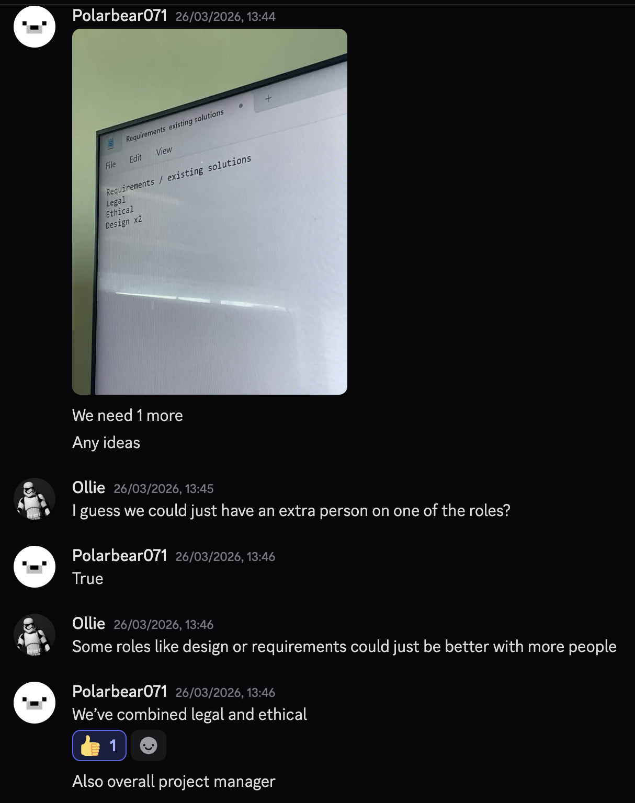

# Group Meeting Log Draft (Sprint 1) 26/03

> **Team Name / Group Number:** Group 8

---

## 1. Attendance

List all team members and mark **P** (present), **A** (absent), or **L** (late).
[Excel Spreadsheet](evidence/Group_Meetings_Evidence.xlsx)

| Name    | Role (if applicable) | Attendance |
| ------- | -------------------- | ---------- |
| Paul    |                      | P          |
| Gabriel |                      | P          |
| Lacku   |                      | P          |
| Leo     |                      | P          |
| Yuvraj  |                      | P          |
| Ollie   |                      | P (online) |

---

## 2. Meeting Purpose

This meeting was held to look over overall project requirements to assign roles and responsibilities to each member of the group. 

## 3. Agenda Items

List the planned discussion items.

1. Review overall requirements
2. Create roles
3. Assign roles

---

## 4. Discussion Summary

## 5. Decisions Made

Use bullet points for clarity. Include rationale where relevant.

- **Decision:**  
  **Reasoning:**
- **Decision:**  
  **Reasoning:**

## 6. Actions and Responsibilities

Clear, assigned tasks with deadlines.

| Task | Assigned To | Due Date | Status                               |
| ---- | ----------- | -------- | ------------------------------------ |
|      |             |          | Not started / In progress / Complete |
|      |             |          |                                      |
|      |             |          |                                      |

## 7. Next Meeting

**Proposed Date & Time:** 
01/04/26
**Proposed Agenda Items:** 
Begin Sprint 2