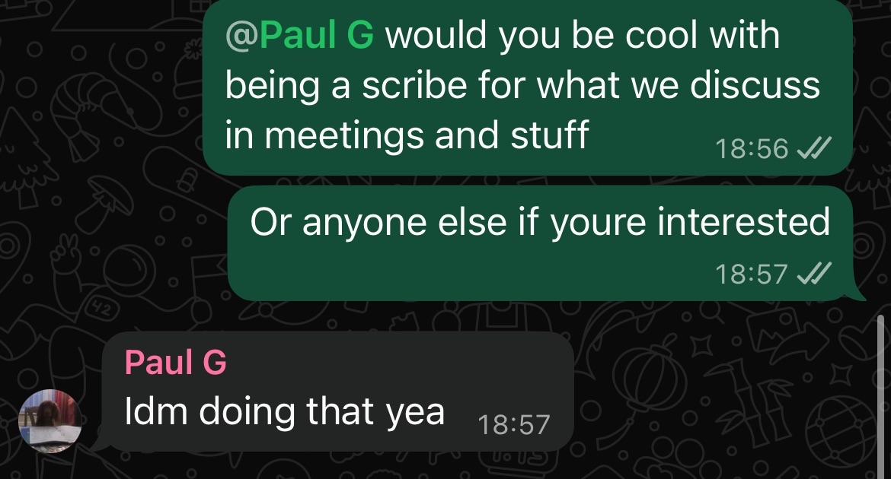
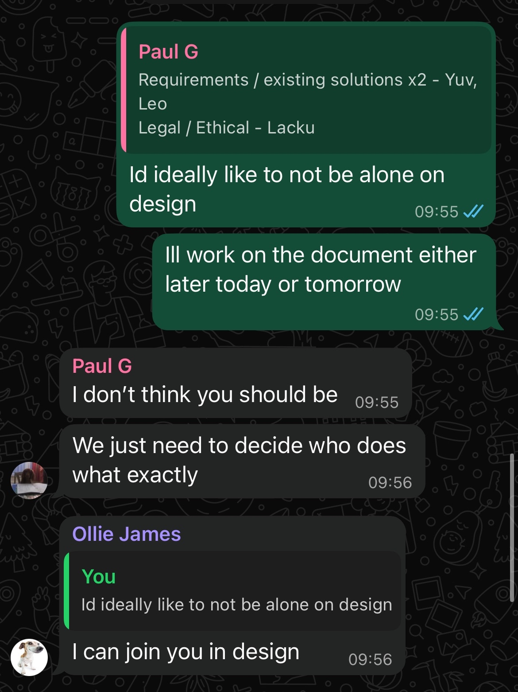
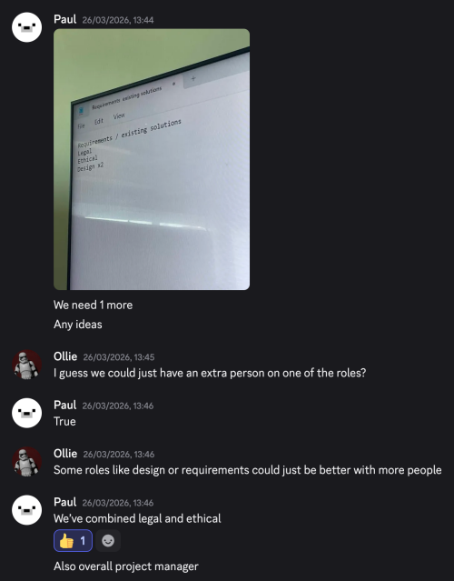

# Group Meeting Log Template (Sprint 1)

<!-- You should create one log per meeting. We expect to see at least 4 formal meetings. Create copies of this template for each meeting. -->
<!-- Logs should be in valid markdown. You can find a guide here: https://www.markdownguide.org/basic-syntax/ -->

> **Team Name / Group Number:**

Group 8 

## 1. Attendance

List all team members and mark **P** (present), **A** (absent), or **L** (late).

| Name | Role (if applicable) | Attendance |
| ---- | -------------------- | ---------- |
|   Gabriel   |        UI/UX Design & Meeting Log Editor           |      **P**      |
|   Yuvraj   |         Requirements Research / Existing Solutions              |     **P**       |
|   Lacku   |       Legal/Ethical Considerations Research               |     **P**       |
|   Leo   |         Requirements Research / Existing Solutions             |       **P**     |
|   Paul   |       Project Manager & Meeting Scribe              |      **P**      |
|   Ollie   |      UI/UX Design                |     **P**   (*)    |
(*) Present via online meeting due to illness

  

---

## 2. Meeting Purpose

<!-- A short sentence outlining why this meeting was held.

Examples:

- Refining user stories
- Agreeing design architecture
- Preparing for formative checkpoint
- Reviewing risks and assumptions
- Allocating tasks and deadlines -->

- Initial team meeting to agree on roles and responsibilities
- Discussed existing solutions and their problems to create innovative features.
- Considered target audience for this project. Briefly discussed what their needs & wants would be for this service in preparation for Sprint 2.
  
## 3. Agenda Items

List the planned discussion items.

1. Epics, personas, user stories and scenarios.
2. Discuss in more depth our own desired features for such a videogame database.

---

## 4. Discussion Summary

- Discussed what roles are delegated to each person
- Followed up further on who to split UI/UX role with, and creation on new role to record what is discussed in meetings.
- Decided that online meetings/hybrid would be a superior way to meet formally as not all of us will be on campus this easter break.

[Text file containing initial roles](evidence/sprint1/Roles.txt)  
  
  
  

## 5. Decisions Made

Use bullet points for clarity. Include rationale where relevant.

**Decision:**  
- Roles are flexible, meaning that each person can take other responsibilities beyond their role.  
**Reasoning:**  
- This will improve workflow and ensure every team member has something to do should they find themselves unoccupied.  
**Decision:**  
- Currently existing solutions will be researched and key features will be noted down, including user experience.  
**Reasoning:**  
- We do not want to waste time reinventing the wheel. We only want to improve on existing solutions by considering would-be users. This approach is significantly more efficient.  
**Decision:**  
- Formal meetings will be held at least once a week over easter break.  
**Reasoning:**  
- This means progress per sprint, allowing for more work done in a week should we have everything done for a given sprint.  

## 6. Actions and Responsibilities

Clear, assigned tasks with deadlines.

| Task | Assigned To | Due Date | Status                               |
| ---- | ----------- | -------- | ------------------------------------ |
|      |             |          | Not started / In progress / Complete |
|      |             |          |                                      |
|      |             |          |                                      |

So far, no tasks have been assigned during this first sprint.

## 7. Next Meeting

**Proposed Date & Time:**  
1/4/26
@ Approx. 17:30
**Proposed Agenda Items:**  
- Epics, user stories, persons and scenarios.
- Analysis of issues in existing solutions.
