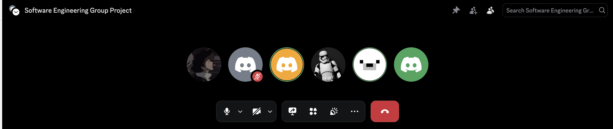
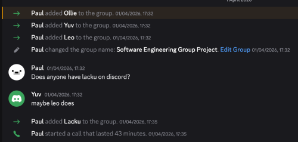
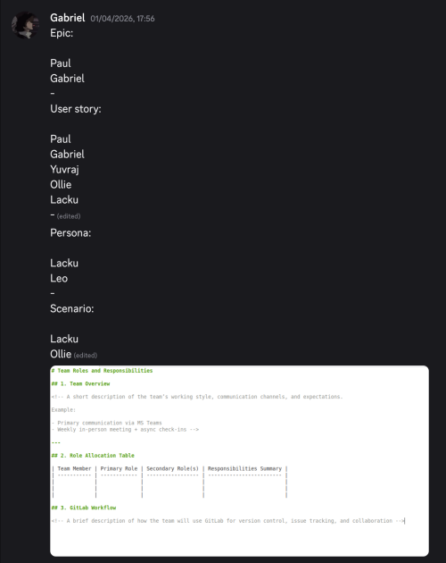
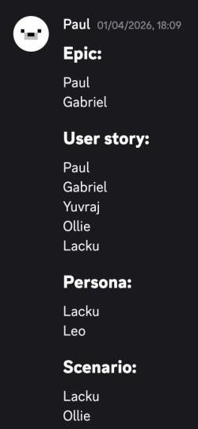

# Group Meeting Log Draft (Sprint 2) 01/04

> **Team Name / Group Number:** Group 8

---

## 1. Attendance

List all team members and mark **P** (present), **A** (absent), or **L** (late).

| Name    | Role (if applicable) | Attendance |
| ------- | -------------------- | ---------- |
| Paul    |                      | P          |
| Gabriel |                      | P          |
| Lacku   |                      | P          |
| Leo     |                      | P          |
| Yuvraj  |                      | P          |
| Ollie   |                      | P          |

---

## 2. Meeting Purpose

Understanding our individual roles and looking at the next steps:
- Researching what the epic, user stories, personas and scenario involves
- Splitting the workload between the team to work on each of these over the next week

## 3. Agenda Items

List the planned discussion items.

1. Research epic, persona, scenario, user stories
2. 
3. Divide workload between everyone in the team

---

## 4. Discussion Summary

## 5. Decisions Made

- **Decision:** 5 people do a user story each
  **Reasoning:** Rather than multiple people working on one or someone doing them then someone else adding to it we thought we would just do one each then look at them all together in the next meeting so we can work on it in our own time a little easier
- **Decision:** 2 people on each of the other required areas
  **Reasoning:** Can help the other person and figure it out together / give an idea each and then either both can be used if two are required / one idea is used and the other can give extra ideas and refinements for the final one
- **Decision:** Ensure everyone has a role to do for this sprint
- **Reasoning:** Although we have separate official roles, it made sense to give work to everyone on the team for this sprint so everyone had something to do and to get a range of ideas by using everyone rather than just one or two people whilst everyone else had nothing to do

## 6. Actions and Responsibilities

| Task         | Assigned To                         | Due Date | Status                               |
| ------------ | ----------------------------------- | -------- | ------------------------------------ |
| Epics        | Paul & Gabriel                      | 08/04    | Not started / In progress / Complete |
| User Stories | Paul, Gabriel, Yuvraj, Ollie, Lacku | 08/04    |                                      |
| Personas     | Lacku, Leo                          | 08/04    |                                      |
| Scenarios    | Lacku, Ollie                        | 08/04    |                                      |

## 7. Next Meeting

**Proposed Date & Time:** 
Wednesday 8th April

**Proposed Agenda Items:** 
Look at work done over the week and:
- Decide on final & refine epic
- Refine user stories
- Refine personas
- Decide on final & refine scenario
