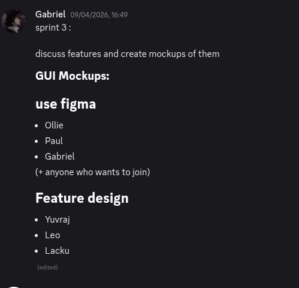

# Group Meeting Log Template (Sprint 3)

<!-- You should create one log per meeting. We expect to see at least 4 formal meetings. Create copies of this template for each meeting. -->
<!-- Logs should be in valid markdown. You can find a guide here: https://www.markdownguide.org/basic-syntax/ -->

> **Team Name / Group Number:** 
Group 8
---

## 1. Attendance

List all team members and mark **P** (present), **A** (absent), or **L** (late).

| Name    | Role (if applicable) | Attendance |
| ------- | -------------------- | ---------- |
| Paul    |                      | P          |
| Gabriel |                      | P          |
| Lacku   |                      | P          |
| Leo     |                      | P          |
| Yuvraj  |                      | P          |
| Ollie   |                      | P          |

---

## 2. Meeting Purpose

<!-- A short sentence outlining why this meeting was held. -->
- Ensure combination of all work from sprint 2 into one document
- Confirming who will be coming up with features for designers to implement
- Confirming who will be doing UI design.
- Familiarizing ourselves with Figma, how it is used and how it works

## 3. Agenda Items

List the planned discussion items.

1. Who will be using Figma.
2. Who will be coming up with features to implement.
3. Whether or not Sprint 2 is complete.

---

## 4. Discussion Summary

Concise notes capturing what was discussed, decisions made, alternatives considered.
Ensure you show evidence (e.g., screenshots, links to resources) of the discussion.

## 5. Decisions Made

Use bullet points for clarity. Include rationale where relevant.

- **Decision:**  
- Gabriel, Ollie and Paul will be doing UI/UX design    
  **Reasoning:**  
- Gabriel's main role is UI - therefore this role mainly falls on him. Paul and Ollie have volunteered to contribute to UI also. This will split workload nicely between the two teams. 
- **Decision:**  
- Yuvraj, Leo and Lacku will be coming up with UI/UX features.  
  **Reasoning:**  
- The site must acknowledge the UI/UX features that are needed and wanted. Brainstorming is needed for this, and it nicely splits workload and makes development more efficient.  
- **Decision:**  
- Use Figma for UI Design 
- **Reasoning:**   
- Figma is easy to use for UI mockups and easy to collaborate on. 

## 6. Actions and Responsibilities

Clear, assigned tasks with deadlines.

| Task | Assigned To | Due Date | Status                               |
| ---- | ----------- | -------- | ------------------------------------ |
|UI/UX planning|Leo, Yuvraj, Lacku|23/4/26|Complete|
|UI/UX mockup design|Gabriel, Ollie, Paul|23/4/26|Complete|

## 7. Next Meeting

**Proposed Date & Time:**     
23/4/26   
**Proposed Agenda Items:**    
- Review UI Designs & Stage 3 word
- Planning Legal & Ethical research
- Discussing how to update SQL Schema to accommodate new features from Sprint 3