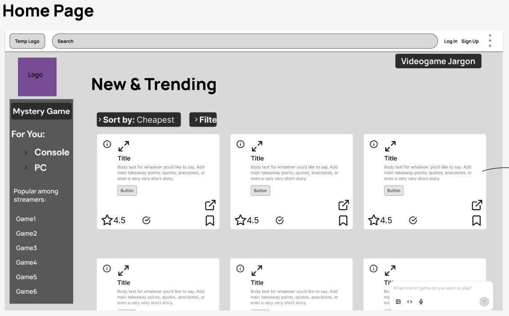
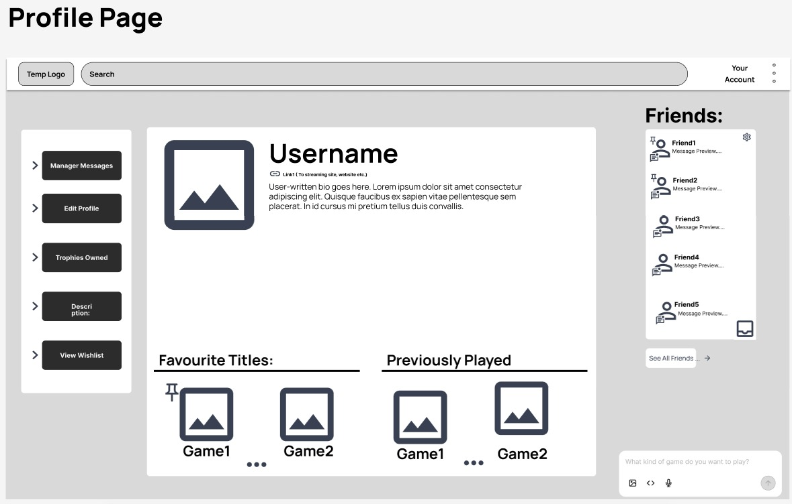
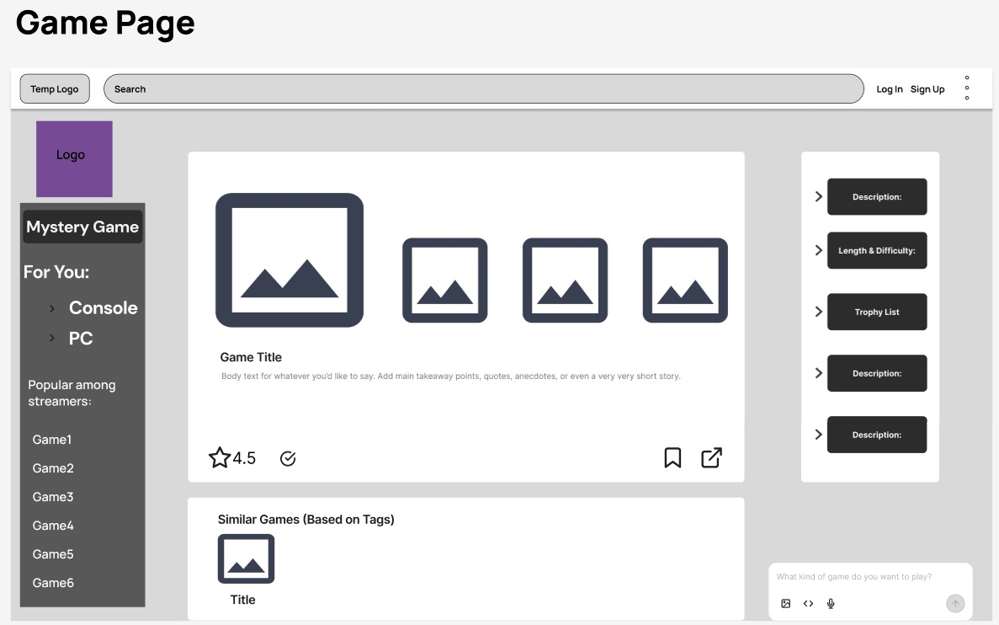

# Group Meeting Log Draft (Sprint 4) 23/04/26

> **Team Name / Group Number:** Group 8

---

## 1. Attendance

List all team members and mark **P** (present), **A** (absent), or **L** (late).

| Name    | Role (if applicable) | Attendance |
| ------- | -------------------- | ---------- |
| Paul    | Design               | P          |
| Gabriel | Design               | P          |
| Lacku   | Concept              | P          |
| Leo     | Concept              | P          |
| Yuvraj  | Concept              | P          |
| Ollie   | Design               | P          |

---

## 2. Meeting Purpose

Review current UI designs for the application to receive feedback and brainstorm ideas.
## 3. Agenda Items

List the planned discussion items.

1. Show current designs to all group members
2. Discuss changes to be made to group designs
3. Discuss sprint 4 - architecture, legislation, ethical concerns, SQL schemas
4. Discuss role allocations for this sprint

---

## 4. Discussion Summary

- Decided that we needed mobile page designs, so we now need to convert these into vertical pages for phones.
- The database schema needs to be kept fairly abstract
- Legislation and ethical research needs to be fairly in depth

## 5. Decisions Made

Use bullet points for clarity. Include rationale where relevant.

- **Decision:**
-   Create mobile designs  
  **Reasoning:**
- GameFinder is intended to be a mobile application, so needs vertical designs to accommodate mobile devices 
- **Decision:**  
- Database Schema must be kept abstract     
  **Reasoning:**    
- We do not want to overcomplicate this design with features that are too advanced as this would quickly increase workload.

## 6. Actions and Responsibilities

Clear, assigned tasks with deadlines.

| Task| Assigned To | Due Date | Status|
| --------------- | ---------- | -------- | ----------- |
| Create vertical UI designs, refine designs, add features | Paul, Gabriel, Ollie |3/5/26|Complete |
| Begin sprint 4 - legislation, databases, architecture|Leo, Lacku,Yuvraj|3/5/26|Complete|
|Complete all documentation|Gabriel|3/5/26   |Complete|

## 7. Next Meeting

**Proposed Date & Time:**
N/A
**Proposed Agenda Items:**
N/A
