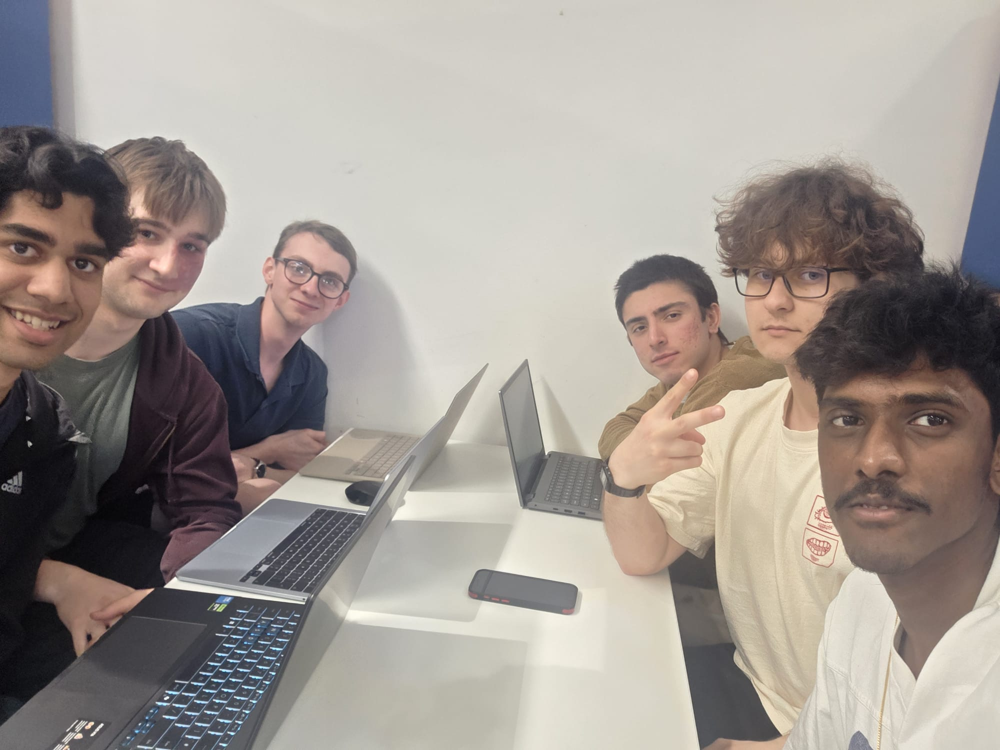

# Group Meeting Log Draft (Sprint 4) 23/04/26

> **Team Name / Group Number:** Group 8

---

## 1. Attendance

List all team members and mark **P** (present), **A** (absent), or **L** (late).

| Name    | Role (if applicable) | Attendance |
| ------- | -------------------- | ---------- |
| Paul    | Design               | P          |
| Gabriel | Design               | P          |
| Lacku   |                      | P          |
| Leo     |                      | P          |
| Yuvraj  |                      | P          |
| Ollie   | Design               | P          |

---

## 2. Meeting Purpose

Review current UI designs for the application to receive feedback and brainstorm ideas.
## 3. Agenda Items

List the planned discussion items.

1. Show current designs to all group members
2. Discuss changes to be made to group designs
3. Discuss sprint 4

---

## 4. Discussion Summary

Decided that we needed mobile page designs, so we now need to convert these into vertical pages for phones.

## 5. Decisions Made

Use bullet points for clarity. Include rationale where relevant.

- **Decision:**  Create vertical designs
  **Reasoning:** GameFinder is intended to be a mobile application, so needs vertical designs to accommodate mobile devices
- **Decision:**  
  **Reasoning:**

## 6. Actions and Responsibilities

Clear, assigned tasks with deadlines.

| Task                                                     | Assigned To          | Due Date | Status                               |
| -------------------------------------------------------- | -------------------- | -------- | ------------------------------------ |
| Create vertical UI designs, refine designs, add features | Paul, Gabriel, Ollie |          | Not started / In progress / Complete |
| Begin sprint 4                                           | Leo, Lacku, Yuvraj   |          |                                      |

## 7. Next Meeting

**Proposed Date & Time:**

**Proposed Agenda Items:**
Catch up with Sprint 4 progress
